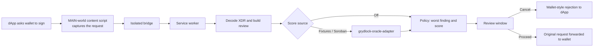

# Gryd Lock

[](https://github.com/Gryd-lock/grydlock-extension/actions/workflows/ci.yml)
[](LICENSE)
[](package.json)

A Chromium browser extension for Stellar users. It shows a plain review and a risk warning before your wallet signs a transaction, and it says "Unknown" instead of guessing when it has no risk data.

## Why it matters

Stellar transactions settle in seconds and cannot be reversed, so the only point where a user can be protected is before they sign. Wallet confirmation screens show raw operations that most people cannot evaluate: a signer change, an account merge or an opaque Soroban call looks as routine as a payment. Pre-signing scanners exist on Ethereum, but they rely on a single injected provider. Stellar has none: each wallet has its own signing channel, so interception has to be built wallet by wallet. Gryd Lock does that, starting with Freighter and Albedo.

## Status

| Area                                              | Status       | Notes                                                                                                                                                                                                  |
| ------------------------------------------------- | ------------ | ------------------------------------------------------------------------------------------------------------------------------------------------------------------------------------------------------ |
| Freighter interception (`SUBMIT_TRANSACTION`)     | ✅ Working   | E2E-tested against the built extension. Chrome does not guarantee Gryd Lock's listener runs before the wallet's own, which is a known limit of this approach ([coverage](docs/protection-coverage.md)) |
| Albedo popup interception (`tx` / `pay` with XDR) | ✅ Working   | Unit-tested, not yet E2E-tested. Implicit-flow and SEP-0007 Albedo routes are not intercepted                                                                                                          |
| Local transaction review                          | ✅ Working   | Every classic operation, fee-bumps, memos and bounded Soroban analysis. Each operation is labelled understood, partial or opaque                                                                       |
| Warning tiers and Cancel / Proceed gates          | ✅ Working   | Low / Elevated / High / Critical, plus **Unknown** when no score exists                                                                                                                                |
| Destination score: **Off** (default)              | ✅ Working   | No score and no network requests. Reviews without other findings show Unknown                                                                                                                          |
| Destination score: **Testkit fixtures**           | 🟡 Mocked    | Synthetic scores for `grydlock-testkit` addresses. Testnet only; refused on any other network                                                                                                          |
| Destination score: **Soroban oracle**             | 🟡 Stubbed   | Real RPC calls through `grydlock-oracle-adapter`, but **no oracle contract is deployed**, so every lookup reports "assessment unavailable"                                                             |
| Toolbar protection status                         | ✅ Working   | Per-tab handshake health, not a guarantee of interception order                                                                                                                                        |
| Decision history (local only)                     | 🟡 Partial   | Records only decisions on scored destinations, so with scoring off it records nothing                                                                                                                  |
| Asset-level risk checks (e.g. scam trustlines)    | ⬜ Not built |                                                                                                                                                                                                        |
| Other wallets (xBull, Lobstr, Rabet, Hana)        | ⬜ Not built |                                                                                                                                                                                                        |
| Firefox, Safari, mobile                           | ⬜ Not built |                                                                                                                                                                                                        |
| Chrome Web Store listing                          | ⬜ Not built | No published release yet. TODO: link the first [GitHub Release](https://github.com/Gryd-lock/grydlock-extension/releases) once `v0.1.0` is tagged                                                      |

## Quick start

Requires Node 20+ and Chrome, Brave or Edge. Each command below was checked on a fresh clone: install takes about 15 s and the build about 10 s.

```bash
git clone https://github.com/Gryd-lock/grydlock-extension && cd grydlock-extension
npm ci            # also builds the grydlock-oracle-adapter dependency
npm run build     # unpacked extension in dist/
npm test          # 368 unit tests
npm run demo      # local test dApp on http://127.0.0.1:5174
```

To see the warning:

1. Open `chrome://extensions`, enable **Developer mode**, click **Load unpacked** and choose `dist/`.
2. Open <http://127.0.0.1:5174> and click **Send** next to _Payment_. The review opens with **Unknown risk**, because scoring is off by default.
3. Open the extension's **Options** page, set the score source to **Testkit fixtures (testnet only)** and save. Send _Payment_ again for **High** (score 55), or _Path payment_ for **Critical** (score 92).

The demo sends unsigned testnet transactions from [`grydlock-testkit`](https://github.com/Gryd-lock/grydlock-testkit) and simulates the wallet's reply, so no wallet or funded account is needed.

E2E tests: `npm run test:e2e` (on Linux without a display, `xvfb-run --auto-servernum npm run test:e2e`).

## How it works



- A content script in the page's own JavaScript context captures the wallet request before the wallet's listener sees it. An isolated bridge script relays it to the service worker. Only the bridge can call `chrome.*`.
- The service worker decodes the exact XDR into a versioned review and asks the configured score source about account destinations. It then applies a single policy: the tier is the worst of the semantic findings and the destination score.
- The review window loads data by an opaque request ID. Its URL never contains XDR, addresses or amounts. Malformed or over-limit requests are cancelled, never forwarded unreviewed.

More detail:

- [Architecture](docs/architecture.md): interception flow, Albedo, review coverage, keyboard behaviour.
- [Protection coverage](docs/protection-coverage.md): what "protected" means, and what is excluded.
- [Threat model](docs/threat-model.md), [permissions](docs/permissions.md) and [privacy](PRIVACY.md).
- [Architecture decisions](docs/adr/README.md) and [design study](docs/design-study.md).

## How it fits in the project

| Repo                                                                              | Relationship to this extension (as implemented in code)                                                                                                                                                                                                                                                                                                |
| --------------------------------------------------------------------------------- | ------------------------------------------------------------------------------------------------------------------------------------------------------------------------------------------------------------------------------------------------------------------------------------------------------------------------------------------------------ |
| [`grydlock-oracle-adapter`](https://github.com/Gryd-lock/grydlock-oracle-adapter) | **Runtime dependency**, commit-pinned. Provides `RiskOracle`, `StubOracle` (fixture scores), `SorobanOracle`, cache, timeout and circuit-breaker middleware. This repo adds the Soroban RPC transport (`src/adapter/sorobanRpcTransport.ts`). Built at install by `scripts/build-oracle-adapter.mjs` because the adapter does not publish build output |
| [`grydlock-testkit`](https://github.com/Gryd-lock/grydlock-testkit)               | **Dev dependency**, commit-pinned. Its testnet transaction XDR and scores drive `demo/`, the E2E tests and adapter tests. The adapter also vendors its scores for `StubOracle`                                                                                                                                                                         |
| [`grydlock-research`](https://github.com/Gryd-lock/grydlock-research)             | **No code dependency.** Its design study is copied into [docs/design-study.md](docs/design-study.md), with notes on where the implementation differs                                                                                                                                                                                                   |

## Project structure

| Path                    | Purpose                                                                                     |
| ----------------------- | ------------------------------------------------------------------------------------------- |
| `src/intercept/`        | Wallet interception (Freighter, Albedo) and the page ↔ bridge protocol                      |
| `src/background/`       | Service worker: request admission, review, popup windows, message validation                |
| `src/signing/`          | Durable pending-request state machine                                                       |
| `src/decode/`           | XDR → versioned transaction review, including Soroban analysis                              |
| `src/review/`           | Review model and the single tier policy                                                     |
| `src/adapter/`          | Score sources on top of `grydlock-oracle-adapter`. The only place network calls are allowed |
| `src/settings/`         | Score-source setting: storage, validation, network policy, UI                               |
| `src/popup/`            | Review window and toolbar status (React)                                                    |
| `src/history/`          | Options page: settings, decision history, local diagnostics                                 |
| `src/protection/`       | Protection-status records and the wallet capability registry                                |
| `demo/`                 | Local test dApp used by the quick start and E2E tests                                       |
| `e2e/`, `tests/visual/` | Playwright end-to-end and visual regression tests                                           |
| `scripts/`              | Build, manifest validation, release packaging                                               |
| `docs/`                 | Architecture, threat model, ADRs, spikes                                                    |

## Roadmap

In priority order:

- [ ] Harden the interception path against hostile pages (capture page-mutable primitives, verify the forwarded payload matches the reviewed digest).
- [ ] Show the requesting site's origin in every review.
- [ ] Review Freighter auth-entry and message-signing requests, which currently pass through unreviewed.
- [ ] Field-level `setOptions` and multi-operation account-takeover detection.
- [ ] Tag `v0.1.0` and publish the first GitHub Release.
- [ ] Point the Soroban score source at a deployed oracle contract (contract work lives in `grydlock-oracle-adapter`).
- [ ] Rabet and Hana wallet adapters.
- [ ] Chrome Web Store submission.

Items 1–4 and 7 have matching [open issues](https://github.com/Gryd-lock/grydlock-extension/issues).

## Contributing

1. Pick an [open issue](https://github.com/Gryd-lock/grydlock-extension/issues). Each one lists the files to touch, acceptance criteria and test expectations. Comment on it before starting.
2. Run the checks locally:
   ```bash
   npm run lint && npm run typecheck && npm test
   npm run build && npm run test:e2e   # when touching interception or the popup
   ```
3. Open a PR against `main` that references the issue. CI runs lint, typecheck, unit tests with coverage, manifest validation, build, visual and E2E tests.

See [CONTRIBUTING.md](CONTRIBUTING.md) for architecture guardrails and the PR checklist, and [docs/development.md](docs/development.md) for quality gates, releases and dependency policy. Report vulnerabilities privately as described in [SECURITY.md](SECURITY.md).

## License

[MIT](LICENSE)
